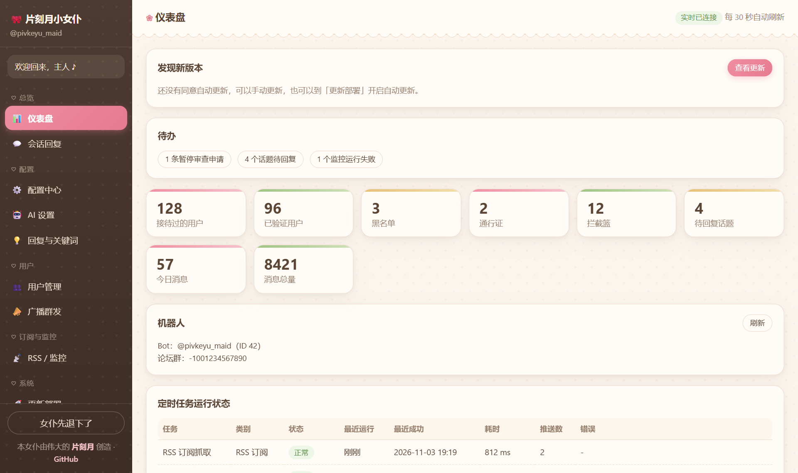
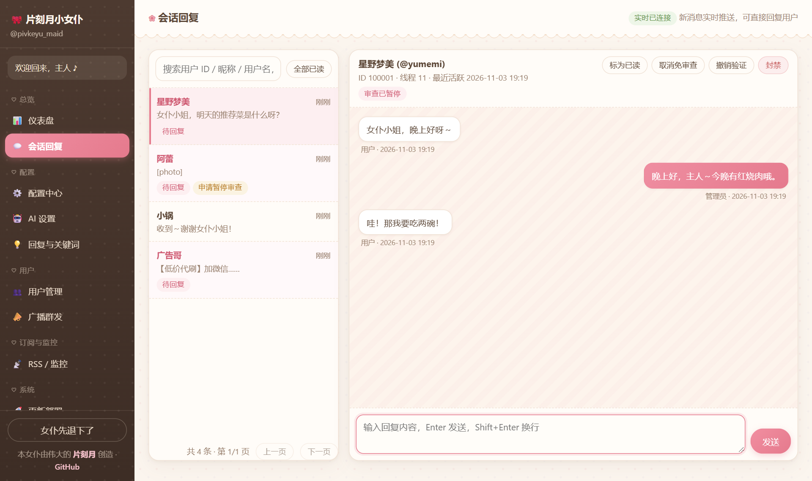
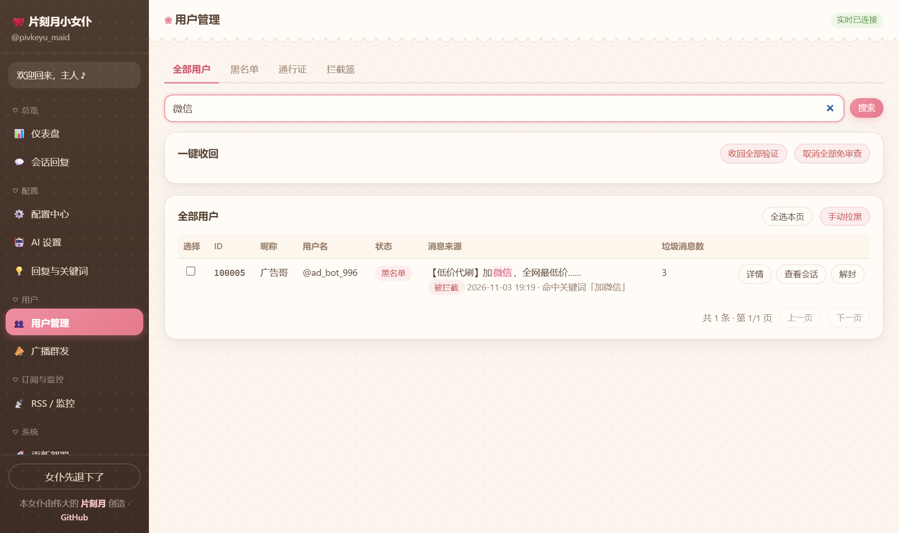
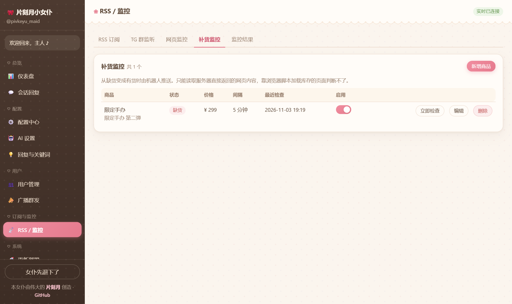
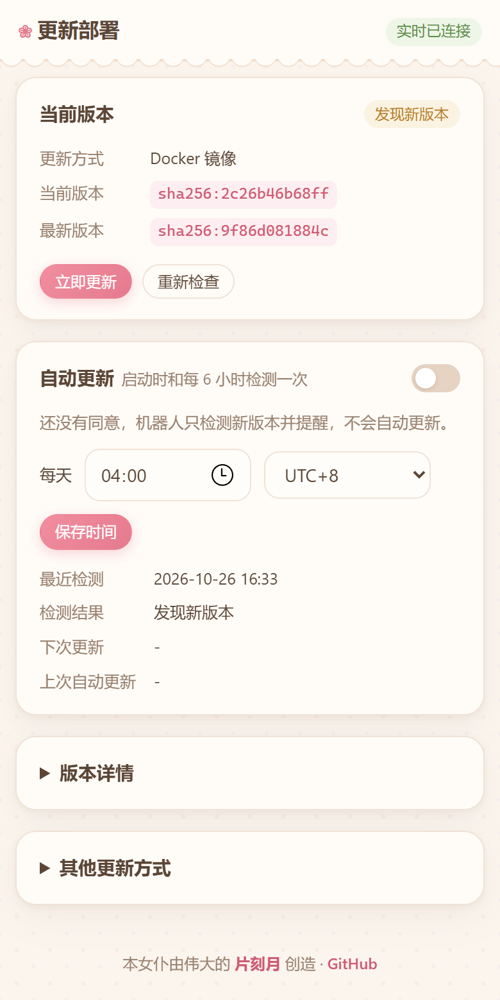
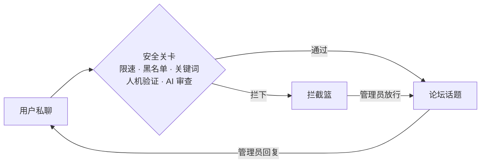

<div align="center">

# 🎀 片刻月小女仆

**把 Telegram 私聊变成论坛话题工单，再配上 AI 审查、人机验证、监控和手机管理页。**

[](https://hub.docker.com/r/pivkeyu/pivkeyu_pmbot)
[](https://github.com/PivKeyU/pivkeyu_pmbot/releases)
[](https://github.com/PivKeyU/pivkeyu_pmbot/actions/workflows/docker-publish.yml)
[](https://www.python.org/)
[](LICENSE)
[](https://github.com/PivKeyU/pivkeyu_pmbot/stargazers)

[快速开始](#-快速开始) · [功能](#-功能) · [文档](#-文档) · [常见问题](docs/faq.md) · [提交问题](https://github.com/PivKeyU/pivkeyu_pmbot/issues)



</div>

## 💡 这是什么

用户私聊机器人，消息自动进入论坛群里属于他的话题；管理员在话题里回复，用户就能收到。不用公开个人账号，也不用担心一堆私聊混在一起。

在这个基础上，它还是一道反骚扰网关和一套轻量运维工具：陌生人要先过人机验证，垃圾消息由 AI 拦下，群聊、网页、RSS 和商品库存都能监控并由机器人推送，手机上打开 Mini App 就能管理。

## ✨ 为什么选它

- **一条命令部署**：一个容器、一个 SQLite 文件，不需要额外的数据库服务，支持 amd64 和 arm64。
- **不配 AI 也能跑**：没有 API Key 时，验证自动改用本地题库。配了 Key 再开启审查和自动回复。
- **AI 不绑定厂商**：支持 Gemini、OpenAI 兼容服务和 Claude，内容审查还能单独接决策模型，官方地址和第三方中转都能用。
- **大部分配置不用重启**：在面板里修改后立即生效，少数需要重启的项会标出来。
- **手机上就能管理**：Mini App 免密码打开，管理用户、监控、配置和更新。
- **有自己的性格**：对用户说话的是一位傲娇女仆，不是冷冰冰的客服接口。

## 📸 截图

<table>
  <tr>
    <td width="50%"><br><sub>在网页里实时查看和回复用户</sub></td>
    <td width="50%"><br><sub>搜索消息内容，找到是谁发的</sub></td>
  </tr>
  <tr>
    <td width="50%"><br><sub>商品补货时由机器人推送</sub></td>
    <td width="50%" align="center"><br><sub>手机宽度下的更新部署页</sub></td>
  </tr>
</table>

<sub>截图来自内置的预览模式，数据都是虚构的。运行 `python -m web_panel.preview` 可以自己试试。</sub>

## 🧩 功能

**双向沟通**

- 每位用户一个独立话题，附用户信息卡片
- 支持文本、图片、视频、音频、语音、文档、贴纸和动画
- 双方编辑消息都会同步，`/todo` 汇总待回复的客人
- 记录转发消息的原始来源，可以按内容反查发送者

**安全防护**

- 四道关卡：限速、黑名单、关键词拦截、AI 验证与内容审查
- 优先使用 Cloudflare Turnstile 人机验证，没通过才换图片验证码或文字题
- 误拦的消息可以放行，用户可以申请暂停审查
- 一键收回全部验证或全部免审查权限

**监控推送**

- TG 群和频道关键词监听，支持 Bot 和用户会话两种模式
- 网页新条目、关键词、内容和价格变化提醒
- 商品补货监控，从缺货变有货时推送
- RSS 订阅，所有命中记录集中查看

**管理与运维**

- Web 面板：实时会话、配置中心、用户管理、广播分组、更新部署
- Telegram Mini App：手机管理页，不含回复功能
- 用户备注、标签、批量分组，按分组或标签广播
- SSH 远程 Ping 和路由追踪
- 经用户同意后定时自动更新，重启前先验证 Bot Token

## 🔄 工作方式



## 🚀 快速开始

**准备三样东西**

| 项目 | 获取方式 |
| :--- | :--- |
| Bot Token | 在 [@BotFather](https://t.me/BotFather) 发 `/newbot` |
| 论坛群 | 创建超级群组并开启 Topics，把机器人设为管理员 |
| 管理员 ID | 你的 Telegram 用户 ID，可以私聊机器人发 `/myid` 查看 |

**1. 下载配置**

```bash
mkdir tg-bot-data && cd tg-bot-data
wget https://raw.githubusercontent.com/PivKeyU/pivkeyu_pmbot/main/docker-compose.yml
wget https://raw.githubusercontent.com/PivKeyU/pivkeyu_pmbot/main/.env.example -O .env
```

**2. 填写必填项**

编辑 `.env`：

```env
BOT_TOKEN=123456:your-token
FORUM_GROUP_ID=-1001234567890
ADMIN_IDS=123456789
```

论坛群 ID 可以在机器人启动后，到群里发 `/myid` 查看，填好再重启一次。

**3. 启动**

```bash
docker compose up -d
docker compose logs -f --tail=100
```

用另一个账号私聊机器人发条消息，完成验证后，消息会出现在论坛群里。

**打开 Web 面板**

面板默认只绑定服务器本地地址。远程服务器先建 SSH 隧道：

```bash
ssh -L 18080:127.0.0.1:18080 用户名@服务器地址
```

然后打开 `http://127.0.0.1:18080`，15 分钟内设置登录密码。公网访问、源码部署和备份见 [部署指南](docs/deployment.md)。

> [!WARNING]
> 不要把未设置密码的面板直接开放到公网。远程访问请先设置强密码，再通过 HTTPS 反向代理提供服务。

## ⌨️ 常用命令

| 命令 | 作用 |
| :--- | :--- |
| `/todo` | 查看待回复的客人 |
| `/mobile` | 打开手机管理页 |
| `/ban`、`/unban` | 拉黑、解除拉黑 |
| `/pass` | 管理免审查通行证 |
| `/reverify` | 收回验证，让用户重新验证 |
| `/announce` | 向用户群发公告 |
| `/restock` | 管理补货监控 |
| `/help 命令名` | 查看某条命令的用法 |

普通用户只会看到 `/start`、`/help`、`/myid`。旧命令名仍然可用，完整列表见 [命令参考](docs/commands.md)。

## 📚 文档

| 文档 | 内容 |
| :--- | :--- |
| [部署指南](docs/deployment.md) | Docker、源码部署，更新、备份、上线检查 |
| [配置参考](docs/configuration.md) | 全部环境变量和功能启用速查 |
| [Web 面板与 Mini App](docs/web-panel.md) | 面板功能、Turnstile、反向代理、安全机制 |
| [命令参考](docs/commands.md) | 全部命令和新旧名称对照 |
| [安全防线](docs/security.md) | 关卡顺序、验证、审查、申诉与放行 |
| [监控](docs/monitoring.md) | TG 监听、网页监控、补货监控、RSS |
| [运维工具](docs/operations.md) | 网络测试、广播、更新、重启 |
| [开发指南](docs/development.md) | 架构、目录结构、开发约定、技术栈 |
| [人设与语气](docs/persona.md) | 女仆角色设定和文案规范 |
| [常见问题](docs/faq.md) | 消息收不到、监控不推送等排查方法 |

## 🤝 参与贡献

欢迎提交 Issue 和 Pull Request，开始前请看 [贡献指南](CONTRIBUTING.md)。

## 📄 许可证

本项目由 [片刻月](https://github.com/PivKeyU) 设计开发，基于 [MIT 许可协议](LICENSE) 开源。分发或修改时请保留版权声明和作者署名。

署名统一定义在 `utils/about.py`，Web 面板的署名在 `web_panel/static/js/app.js` 的 `ABOUT` 常量里。

<div align="center">

如果这个项目对你有帮助，欢迎点一个 ⭐

</div>
