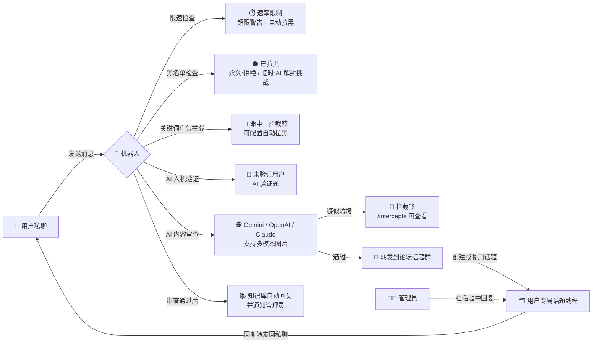

# 开发指南

[← 返回 README](../README.md) · [文档目录](../README.md#-文档)

架构、本地运行、目录结构和开发约定。



> 管理员在话题中的回复与**编辑**都会被同步回用户的私聊会话；用户的编辑同样会同步到话题中。

一条消息在抵达管理员之前，要**按固定顺序**依次穿过四道关卡，全部通过后才会被转发到话题群：

```text
限速 → 黑名单 → 关键词广告拦截 → AI 人机验证 → AI 内容审查 → 通过后转发到话题
```

任一道关卡拦下，管理员都收不到该消息，用户会收到对应的说明文案（详见 [安全防线](security.md)）。

## 项目结构

```text
pivkeyu_pmbot/
├── bot.py                  # 启动入口：初始化数据库、注册命令/处理器、启动轮询
├── config.py               # 环境变量加载与配置校验（python-dotenv）
├── handlers/               # Telegram 事件处理器
│   ├── command_handler.py  #   /manage /todo /pass /groups /announce 等命令
│   ├── user_handler.py     #   用户私聊消息：限速→黑名单→验证→审查→转发
│   ├── admin_handler.py    #   管理员话题回复回传、编辑同步、拦截篮查看
│   └── callback_handler.py #   内联键盘回调（面板、模型衣柜、分页等）
├── services/               # 核心业务服务
│   ├── ai_providers.py     #   AI 协议注册表（协议、预设地址、默认模型）
│   ├── ai_service.py       #   AI 提供商实现（Gemini / OpenAI 兼容 / Claude）+ 本地题库兜底
│   ├── verification.py     #   人机验证（图片 / 文字随机、换题、超限拉黑）
│   ├── captcha_image.py    #   图片验证码生成（Pillow）
│   ├── text_questions.py   #   文字题库与程序化出题器
│   ├── blacklist.py        #   黑名单与 AI 自助解封挑战
│   ├── spam_filter.py      #   关键词广告拦截
│   ├── thread_manager.py   #   论坛话题创建、用户信息卡片、深链
│   ├── rate_limiter.py     #   速率限制（每用户每分钟消息数）
│   ├── tg_monitor.py       #   TG 群/频道监听（bot + Telethon 双模式）
│   ├── web_monitor.py      #   网页监控与补货判断
│   ├── broadcast.py        #   分组广播（文本/媒体 + 话题镜像）
│   ├── telegram_commands.py #   按身份注册 Telegram 命令菜单
│   ├── image_update.py     #   镜像更新（Docker Hub digest 比对 + Watchtower 触发）
│   ├── safe_update.py      #   安全更新（ff-only + 回滚）
│   ├── auto_update.py      #   检测新版本与定时自动更新
│   ├── moderation.py       #   撤销验证、误杀申诉、放行、一键收回
│   ├── monitor_push.py     #   监控结果的机器人推送
│   └── restart.py          #   Token 预检与进程重启
├── web_panel/              # Web 面板与 Mini App（aiohttp、REST API、WebSocket、零依赖前端）
├── rss/                    # RSS 订阅（feedparser + 关键词过滤 + 超时兜底）
├── network_test/           # 网络测试（SSH Ping / NextTrace，防注入）
├── database/               # aiosqlite 连接池与全部建表/迁移
├── utils/                  # 文案层（copy.py）、命令目录（commands.py）、装饰器、Markdown、媒体转换、消息发送
├── tests/                  # pytest 测试
└── watchtower/             # Watchtower 自动更新配置（含 Telegram 通知示例）
```

```bash
git clone https://github.com/PivKeyU/pivkeyu_pmbot.git
cd pivkeyu_pmbot

python -m venv venv
source venv/bin/activate        # Windows: venv\Scripts\activate

pip install -r requirements.txt

cp .env.example .env            # 然后填 BOT_TOKEN / FORUM_GROUP_ID / ADMIN_IDS
python bot.py
```

必填项只有三个：`BOT_TOKEN`、`FORUM_GROUP_ID`、`ADMIN_IDS`。其余变量按需填写，完整清单见 [.env.example](../.env.example)。

**只想看看 Web 面板的界面？** 用假数据预览模式即可，不需要配置任何 Token（数据存内存，改动刷新即恢复）：

```bash
python -m web_panel.preview              # 打开 http://127.0.0.1:18100
python -m web_panel.preview --port 19000 # 自定义端口
```

> `/upgrade` 安全更新基于 git 工作区，因此需要以 `git clone` 方式部署（而不是下载压缩包）；纯镜像部署改走面板里的「检查镜像更新」。

## 代码结构

目录职责如下：

| 路径 | 职责 |
| :--- | :--- |
| `bot.py` | 启动入口：初始化数据库、注册命令与处理器、启动长轮询 |
| `config.py` / `config_meta.py` | 环境变量加载、配置校验与配置项元数据注册表（Web 面板配置中心共用） |
| `web_panel/` | 内嵌 Web 管理面板：aiohttp 服务、认证、REST API、WebSocket 推送与零依赖静态前端 |
| `handlers/` | Telegram 事件处理器：私聊入口、管理员话题回传、内联回调、命令 |
| `services/` | 核心业务：AI 服务、人机验证、黑名单、广告拦截、话题管理、TG 监听、网页监控、广播、安全更新、镜像更新 |
| `rss/` | RSS 订阅（feedparser + 关键词过滤 + 超时兜底） |
| `network_test/` | SSH 远程网络测试（Ping / NextTrace，防注入） |
| `database/` | aiosqlite 连接池、建表与迁移、数据模型 |
| `tests/` | pytest 测试 |
| `utils/` | **集中文案层**、装饰器（`admin_only`）、Markdown、媒体转换、消息发送 |
| `watchtower/` | Watchtower 自动更新配置（含 Telegram 通知示例） |

其中 `utils/copy.py` 是用户可见文案的集中来源，改语气、改称呼优先动这一处。文风规范见 [人设与语气](persona.md)。

## 开发约定

- **新增用户可见文案一律加到 `utils/copy.py`**，不要在业务代码里硬编码字符串。
- **新增命令**要加到 `utils/commands.py` 的目录，并同步 [命令参考](commands.md)。
- **新增环境变量**要同步更新 `config.py`、`config_meta.py` 与 `.env.example`，并补充配置说明。
- **提交前运行测试**：`pytest tests/`，再跑一遍 `black` 与 `flake8`。

# 🧰 技术栈

| 技术 | 用途 |
| :--- | :--- |
| [Python 3.11+](https://www.python.org/) | 开发语言（Docker 基础镜像 `python:3.11-slim`） |
| [python-telegram-bot v20+](https://github.com/python-telegram-bot/python-telegram-bot) | Telegram Bot 框架（长轮询 + 异步） |
| [aiosqlite](https://github.com/omnilib/aiosqlite) | 异步 SQLite，内置 8 连接池与事务安全包装 |
| [Google Gemini](https://ai.google.dev/) | AI 内容审查 / 验证题生成 / 自动回复 / 多模态识别 |
| [OpenAI](https://openai.com/) 兼容协议 | 可选 AI 提供商（DeepSeek / 通义 / Kimi / 智谱等） |
| [Anthropic Claude](https://www.anthropic.com/) | 可选 AI 提供商（Messages 协议） |
| [Telethon](https://github.com/LonamiWebs/Telethon) | 用户会话监听 Bot 无法加入的群/频道 |
| [aiohttp](https://docs.aiohttp.org/) | 异步 HTTP 抓取（网页监控） |
| [BeautifulSoup4](https://www.crummy.com/software/BeautifulSoup/) | 网页 CSS 选择器解析 |
| [feedparser](https://pythonhosted.org/feedparser/) | RSS 解析（socket 超时 + 任务防重叠） |
| [paramiko](https://github.com/paramiko/paramiko) | SSH 远程网络测试（Ping / NextTrace） |
| [Docker](https://www.docker.com/) | 容器化部署（amd64 / arm64 多架构镜像） |
| [Docker Buildx](https://github.com/docker/buildx) + QEMU | CI 多架构镜像构建（`linux/amd64` + `linux/arm64`） |
| [GitHub Actions](https://github.com/features/actions) | push 到 `main` 自动构建并推送镜像到 Docker Hub |
